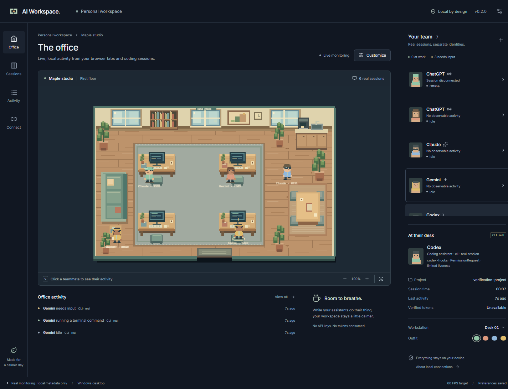

# AI Workspace

A local pixel office for real browser AI tabs and CLI sessions. Version 0.2.0 adds a Chrome MV3 extension, authenticated local bridge, project-scoped CLI hooks, per-session characters and live activity history while preserving the original office design. Fresh installations open in live mode; the optional demo is explicitly simulated.

The screenshot uses provider DOM and hook-contract fixtures to exercise the actual extension, native bridge and Windows UI. See [the exact validation report](docs/MILESTONES-2-3.md).

## Integrations

| Integration | Implemented | Verification |
| --- | --- | --- |
| ChatGPT in Chrome | Visible generation, composer idle, explicit approval waiting, unknown UI, tab disconnect | Actual loaded extension and native pipeline with DOM fixtures; authenticated generation not checked |
| Claude / Gemini in Chrome | Same conservative DOM adapter model | Provider-specific fixtures; authenticated pages not checked |
| Codex CLI | Project hooks, individual sessions, state/task mapping, PID/start-time exit detection | Installed Codex 0.164.0: two actual startup sessions and process cleanup; tools/approval via contract fixtures |
| Claude Code | Project hooks and Node/native ancestor binding | Hook configuration/classification/reporter contract tested; installed-runtime lifecycle not verified |
| Gemini CLI | Project hooks and Node/native ancestor binding | Hook configuration/classification/reporter contract tested; Gemini CLI is not installed in the test environment |
| Cursor / Ollama | Unavailable | No adapter or simulated fallback |

## Start monitoring on Windows

1. Run the Windows app. WebView2 is required. Open **Connect**.
2. Unzip the supplied Chrome extension into a permanent folder. At chrome://extensions, enable Developer mode, choose **Load unpacked**, and select browser-extension.
3. In the desktop app choose **Generate pairing code**, then enter the eight-character code in the extension popup. It expires after two minutes. Reload existing AI tabs once after loading the extension.
4. Open ChatGPT, Claude or Gemini in that paired Chrome profile. Each tab gets its own character. Generating requires a recognized visible stop control; unrecognized/login/challenge pages stay **Unknown**, never fake working.
5. For a CLI, enter an existing project folder in **Connect**, choose providers and click **Install project hooks**. Existing JSON is merged and backed up. Start a new CLI session in that folder. In Codex, trust the project through the normal CLI flow and review/trust the installed definitions via **/hooks**. Managed policy or disabled/untrusted hooks can prevent reporting.

The app must stay open. A running process alone does not imply a model is working. Sessions launched before hooks are installed are not reconstructed from historical logs; later supported events may detect them. Keep the executable at its installed location because project hooks reference that absolute path. Reinstall hooks after moving it. To remove hooks, remove only entries containing --report-hook from the project's provider JSON, or restore a reviewed backup. Browser pairings can be revoked in Connect.

Default data: %APPDATA%/io.github.tweekee.aiworkspace. Do not share bridge-credentials.json. The bridge uses authenticated HTTP on 127.0.0.1:38471 only. It never calls an LLM. Close another app instance if the port is occupied. See [privacy](docs/PRIVACY.md) for retained metadata and local-account security limits.

## Build and run

Install Node.js 24, stable Rust (minimum 1.90), Microsoft C++ Build Tools with Desktop development with C++, Windows SDK and WebView2; see [Tauri prerequisites](https://v2.tauri.app/start/prerequisites/).

~~~powershell
npm ci
npm run desktop:dev
# Build Windows NSIS installer and unpacked extension:
npm run desktop:build
~~~

Native output: src-tauri/target/release/ai-workspace.exe and bundle/nsis/*-setup.exe. Extension output: browser-extension/. The installer is unsigned. Windows CI also uploads installer and extension artifacts.

~~~powershell
npm run dev
~~~

The browser preview at http://127.0.0.1:1420 runs the renderer and demo but explicitly cannot monitor local native sessions. Use the Windows executable for real activity. Fonts, artwork and runtime assets are bundled.

## Validation

~~~powershell
npm test
npm run build
npx playwright install chromium
npm run test:e2e
cargo fmt --manifest-path src-tauri/Cargo.toml -- --check
cargo test --manifest-path src-tauri/Cargo.toml
cargo clippy --manifest-path src-tauri/Cargo.toml -- -D warnings
cargo build --manifest-path src-tauri/Cargo.toml
npm run monitor:test
~~~

The monitoring test launches the actual native bridge, loads the built extension, pairs through its popup, verifies four simultaneous browser tabs and CLI reporter events, rejects web-origin writes and checks metadata filtering. Provider pages are local fixtures and do not call models. With a release build set AI_WORKSPACE_TEST_EXE to its absolute path and run node scripts/test-monitoring.mjs --desktop to also test the native WebView2 UI. The optional --live-sites checks only fresh unauthenticated pages without sending prompts.

Optional installed Codex test: set AI_WORKSPACE_CODEX_EXE to codex.exe and run node scripts/verify-codex-lifecycle.mjs. It uses an isolated QA profile, a local-only provider endpoint, reviewed hooks with the documented one-off hook-trust flag, and a second startup hook that stops execution before inference. Normal product installation never bypasses hook trust or tool approvals.

## Office controls

Each session appears separately in the room, sidebar, activity history and session table. Select a character to see source, observed state/evidence, project basename, liveness confidence and history. Reading, editing, terminal, response and waiting states drive the existing animations. More than four sessions share staggered positions around the four desks. Offline characters remain briefly for context before removal.

Themes, frame caps, reduced motion, labels, furniture placement and outfits remain available. Demo can be enabled in Settings and shows a separate **Simulated** office. No fictional activity is injected into live sessions. Token/cost data remain unavailable. Notifications, autostart, non-Windows CLI hook installation, incognito monitoring and automatic extension installation are unsupported.

See [architecture](docs/ARCHITECTURE.md), [privacy](docs/PRIVACY.md), [M1 history](docs/MILESTONE-1.md), and [dependency attribution](THIRD_PARTY_NOTICES.md). Original application code, procedural pixel art and icon are MIT licensed. No proprietary provider logos or competitor assets are included.
